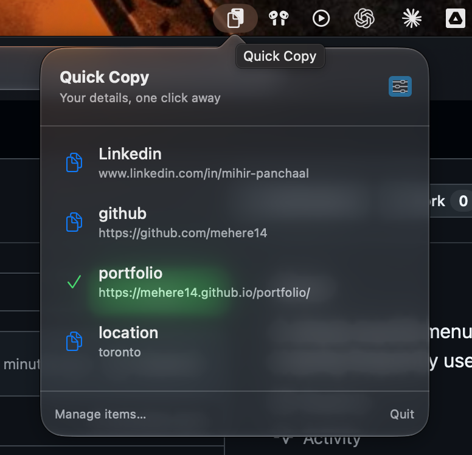
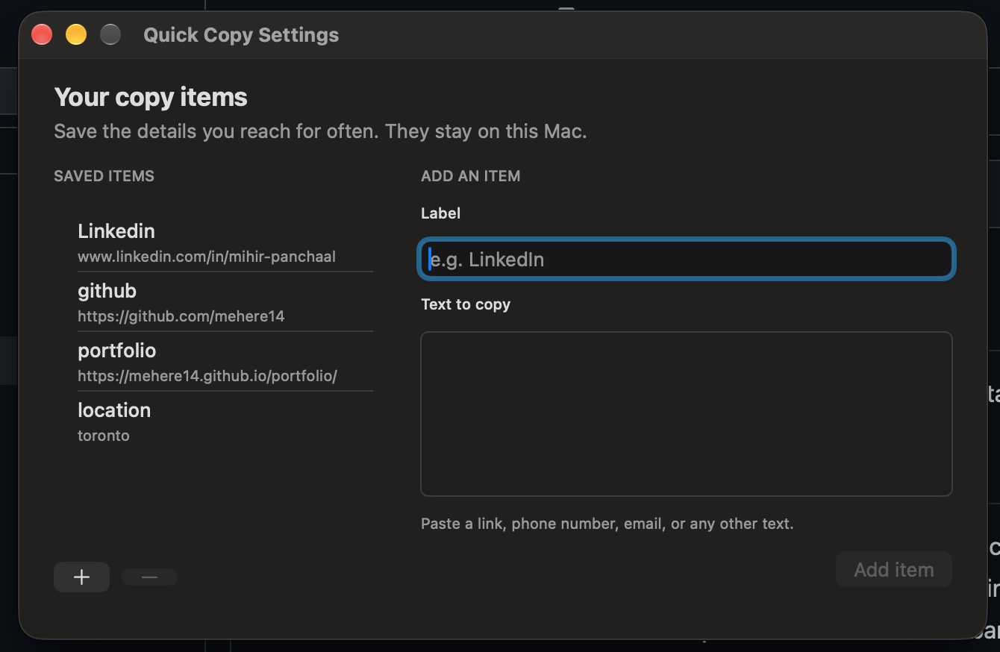

# Quick Copy

A small macOS menu bar app for copying the details you use often.

## Screenshots

Hover over the menu bar icon to copy a saved item:

Add and manage items in settings:

## Use

1. Open `build/Quick Copy.app`. On first launch, the settings window opens.
2. Add a label and the text to copy, such as a LinkedIn URL, email address, or phone number.
3. Hover over the clipboard icon in the menu bar, then click an item to copy it. You can also click the icon to open the panel.
4. Choose **Manage items…** to add, edit, or delete entries. Changes are saved locally on your Mac.

The app has no Dock icon. Choose **Quit** from the menu bar panel to close it. To keep it handy, drag the app to Applications and add it to Login Items in macOS System Settings if you want it to start automatically.

## Build

Requires Xcode and macOS 13 or later. Run `./scripts/build.sh`. The app is created at `build/Quick Copy.app`. The build is ad-hoc signed for local use.
